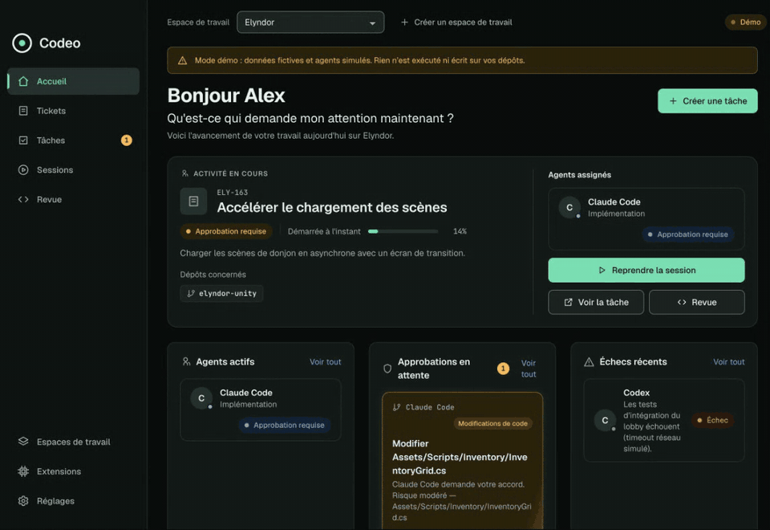
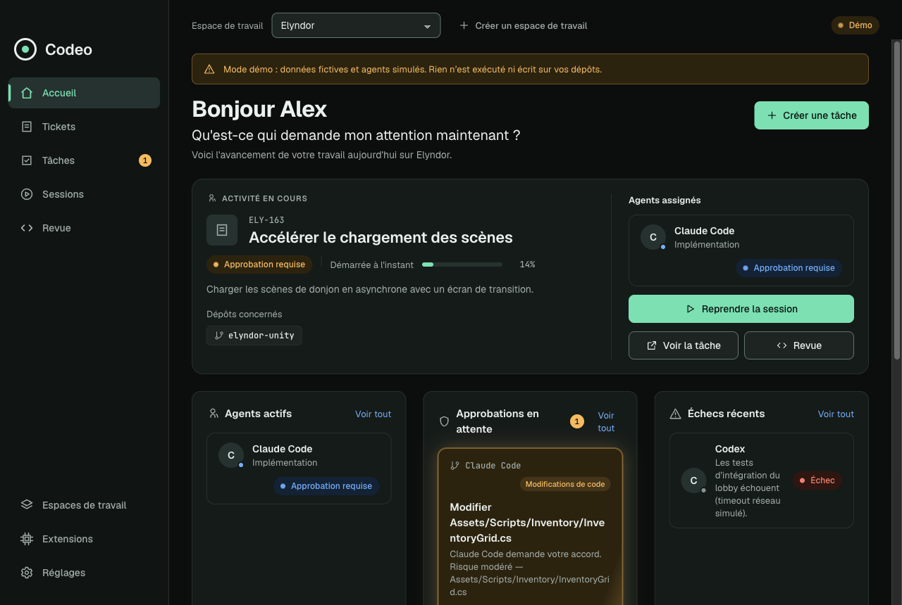
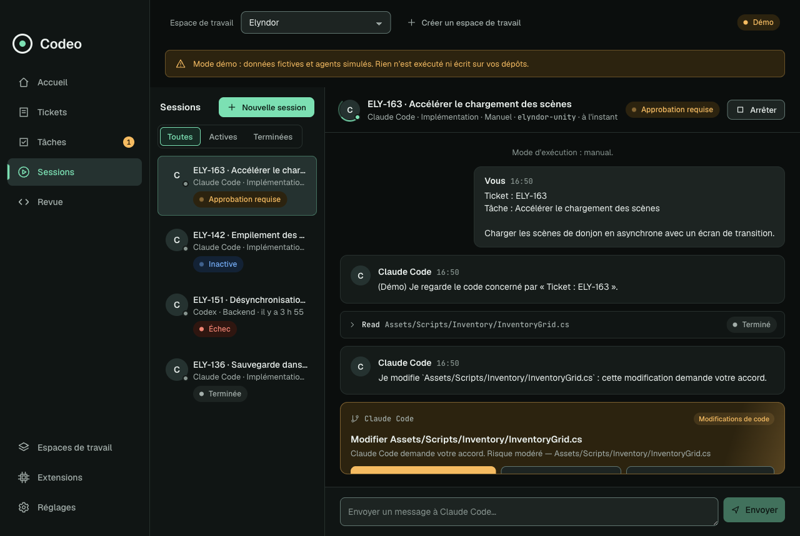
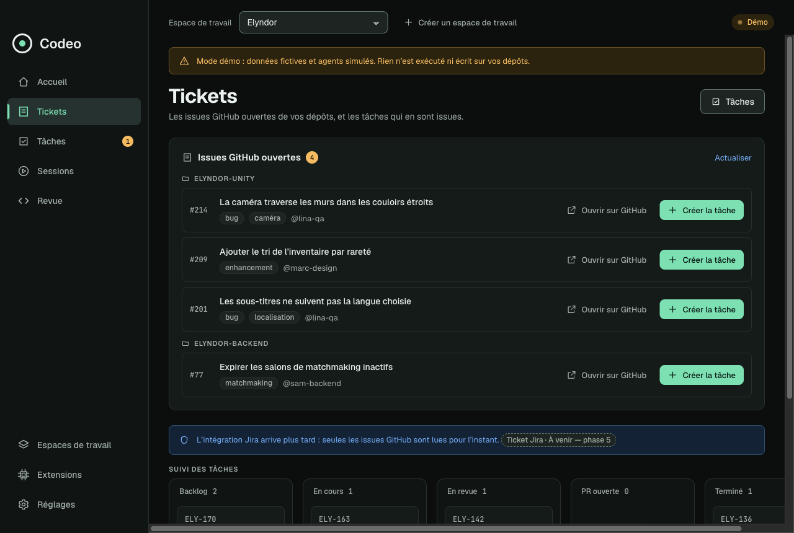
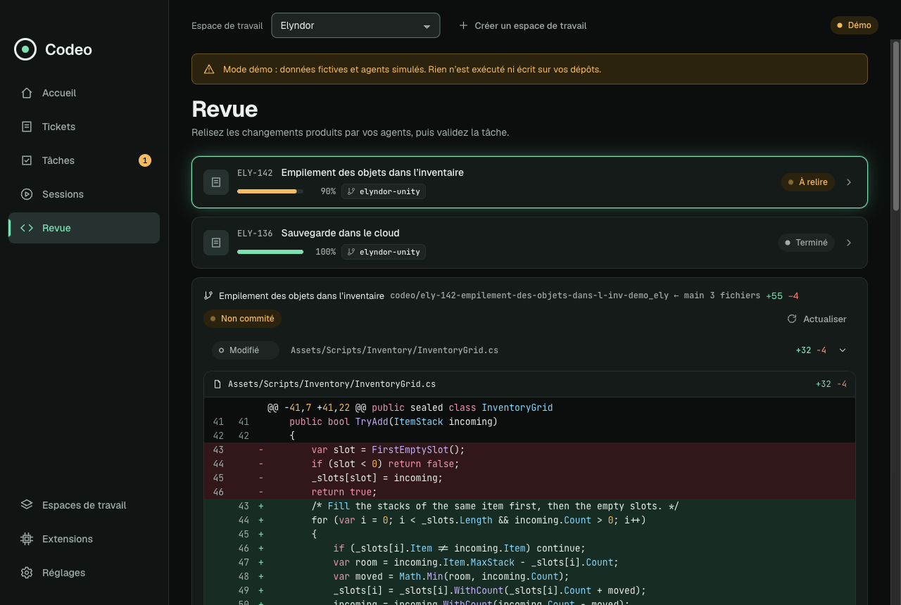

# Codeo

**AI handles complexity. Humans stay in control.**

Codeo is a next-generation development workspace where you orchestrate AI coding agents (Claude Code,
Codex) across Git repositories, follow their sessions live, approve sensitive operations, review the
result and ship pull requests — from your desktop, or remotely from your phone.



<sub>Demo mode: fictional data and simulated agents. The UI is in French by default and switches to English in Settings.</sub>

## How it works

1. **Pick the work** — a GitHub issue from the Tickets screen, or a plain instruction.
2. **Hand it to an agent** — Claude Code or Codex (official SDKs), one agent or several (sequential,
   pipeline, parallel, best-of-N), each in its own Git worktree so your working copy is never touched.
3. **Stay in control** — follow the session live; sensitive actions (file edits, commands, network)
   pause on an approval card until you approve or reject them, on the desktop or on your phone.
4. **Review and ship** — read the diff, comment on lines and send it back to the agent, then complete the
   task and open the pull request; Codeo follows its checks until it is merged.

| Home | Live session and approval |
| --- | --- |
|  |  |
| **Tickets from GitHub issues** | **Review the diff** |
|  |  |

👉 **[User guide](docs/guide/README.md)** — install, demo mode, the everyday loop screen by screen,
execution modes, orchestration, phone pairing.

## Components

| Component | Stack | Status |
| --- | --- | --- |
| Codeo Desktop (`apps/desktop`) | Electron · React · Vite | Workspaces, tickets, tasks, live sessions, approvals, review, pull requests |
| Codeo Runtime (`apps/runtime`) | Node · WebSocket · SQLite (libsql + Drizzle) | Real Claude Code + Codex sessions via official SDKs, worktrees, orchestration |
| Codeo Remote (`apps/mobile`) | Expo · React Native | Pairing by QR, sessions, approvals with Face ID, push notifications |
| Remote Gateway (`apps/gateway`) | Fastify · WebSocket · PostgreSQL | Pairing, tokens, scoped relay, push delivery |

## Quick start

Download a build from the [releases](https://github.com/neocra/codeo/releases), or run from source:

```bash
pnpm install
pnpm typecheck && pnpm test
pnpm dev:desktop
```

You need Git, Claude Code and/or Codex installed and logged in, and the GitHub CLI (`gh auth login`) for
issues and pull requests. No agent at hand? Turn on **Settings → Demo mode** to explore with fictional
data and simulated agents.

The desktop app spawns the runtime as a child process (Electron's binary in Node mode), connects over a
loopback WebSocket with a per-launch token, and shows the Home screen. Create a workspace from a local
Git repository, then create a task and start it: a real Claude Code session streams into the Sessions
screen; permission requests appear as approval cards.

Run the runtime on its own (it writes `~/.codeo/runtime.json` with its URL and token):

```bash
pnpm --filter @codeo/runtime start
```

## Documentation
- [User guide](docs/guide/README.md)
- [Architecture](docs/architecture/overview.md)
- [Design system](docs/design/README.md)
- [Security](docs/security/) · [Remote access](docs/security/remote-access.md)
- [Releases and updates](docs/development/releases.md)
- [Progress & limitations](docs/development/progress.md)
