# Using Codeo

Codeo is where you hand work to coding agents (Claude Code, Codex) and keep the decisions for yourself:
you describe the work, an agent does it in an isolated Git worktree, you approve the sensitive actions,
review the diff and open the pull request.

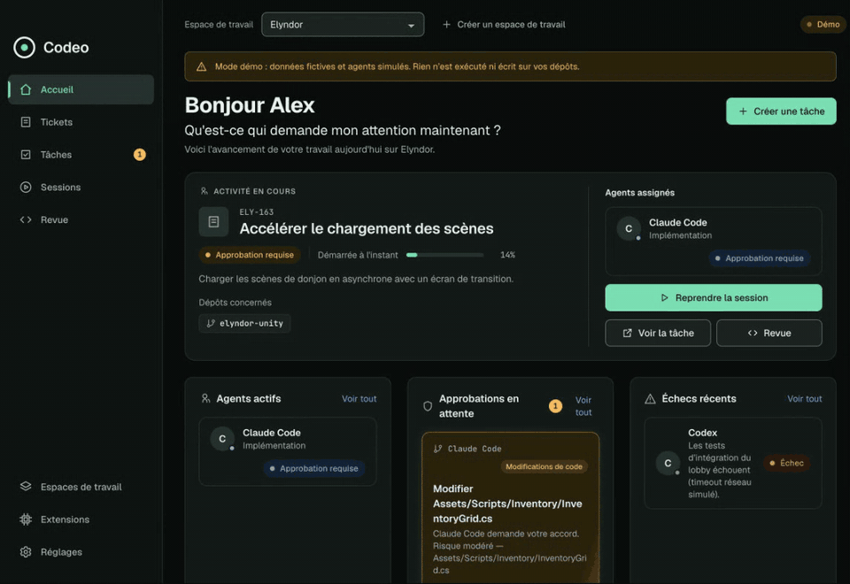

The interface is in French by default; switch it to English in **Réglages → Langue**. Button names below
are given as they appear in the default French UI, with the English label in parentheses. Every capture
in this guide comes from the app running in demo mode (fictional data, simulated agents).

- [Install and first launch](#install-and-first-launch)
- [Try it with the demo](#try-it-with-the-demo)
- [The everyday loop](#the-everyday-loop)
  1. [Create a workspace](#1-create-a-workspace)
  2. [Pick up a ticket](#2-pick-up-a-ticket)
  3. [Create and start a task](#3-create-and-start-a-task)
  4. [Follow the session, decide approvals](#4-follow-the-session-decide-approvals)
  5. [Review the changes](#5-review-the-changes)
  6. [Open the pull request](#6-open-the-pull-request)
- [Home: what needs my attention](#home-what-needs-my-attention)
- [Standalone sessions](#standalone-sessions)
- [Execution modes](#execution-modes)
- [Orchestrating several agents](#orchestrating-several-agents)
- [Settings](#settings)
- [Codeo Remote (phone)](#codeo-remote-phone)
- [Troubleshooting](#troubleshooting)

## Install and first launch

**From a release.** Download the build for your platform from the
[GitHub releases](https://github.com/neocra/codeo/releases): `.dmg` (macOS), `.exe` (Windows),
`.AppImage` / `.deb` (Linux). macOS builds are not notarized yet: on first launch, allow the app in
*System Settings → Privacy & Security → Open Anyway*. Codeo then updates itself from the releases.

**From source.**

```bash
pnpm install
pnpm dev:desktop
```

**What you need on the machine.** Codeo drives the agents you already have; it never fakes one.

| Tool | Used for |
| --- | --- |
| Git | workspaces, worktrees, diffs |
| [Claude Code](https://docs.claude.com/en/docs/claude-code) and/or [Codex](https://github.com/openai/codex), logged in | running the agents (official SDKs) |
| [GitHub CLI](https://cli.github.com/) (`gh auth login`) | reading issues, opening and following pull requests |

**Réglages → Agents IA** (*Settings → AI agents*) shows what was detected: installed or not, version,
authentication, models and capabilities. An agent that is missing is reported as missing.

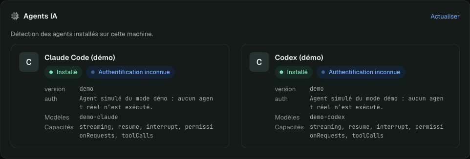

The desktop app starts its runtime (the engine that runs sessions, approvals and worktrees) in the
background and talks to it over a local WebSocket protected by a per-launch token. Your data stays in
`~/.codeo`.

## Try it with the demo

**Réglages → Mode démo → Activer le mode démo** (*Settings → Demo mode → Turn on demo mode*) restarts the
runtime on a separate dataset: two workspaces (*Elyndor*, a multi-repository game, and *Codeo Cloud*, a
monorepo), GitHub issues, tasks at every stage, reviewed diffs and pull requests. The agents are scripted:
nothing is executed or written to your repositories, and a banner says so on every screen. **Revenir au
mode réel** (*Back to live mode*) returns to your own data.

## The everyday loop

### 1. Create a workspace

A workspace groups the repositories of one project. **Espaces de travail → Créer un espace de travail**
(*Workspaces → Create a workspace*): give it a name, choose *Multi-dépôts* (several repositories) or
*Monorepo*, the default execution mode, and pick one or more local Git folders.

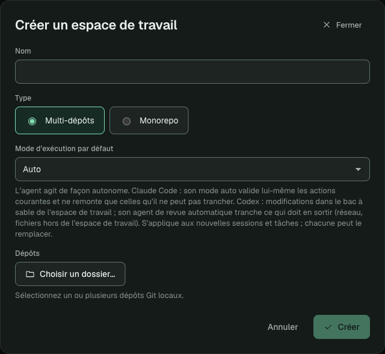

The Workspaces screen lists your projects, their repositories and default branch, and lets you add or
remove repositories later. The selector at the top of every screen switches the active workspace.

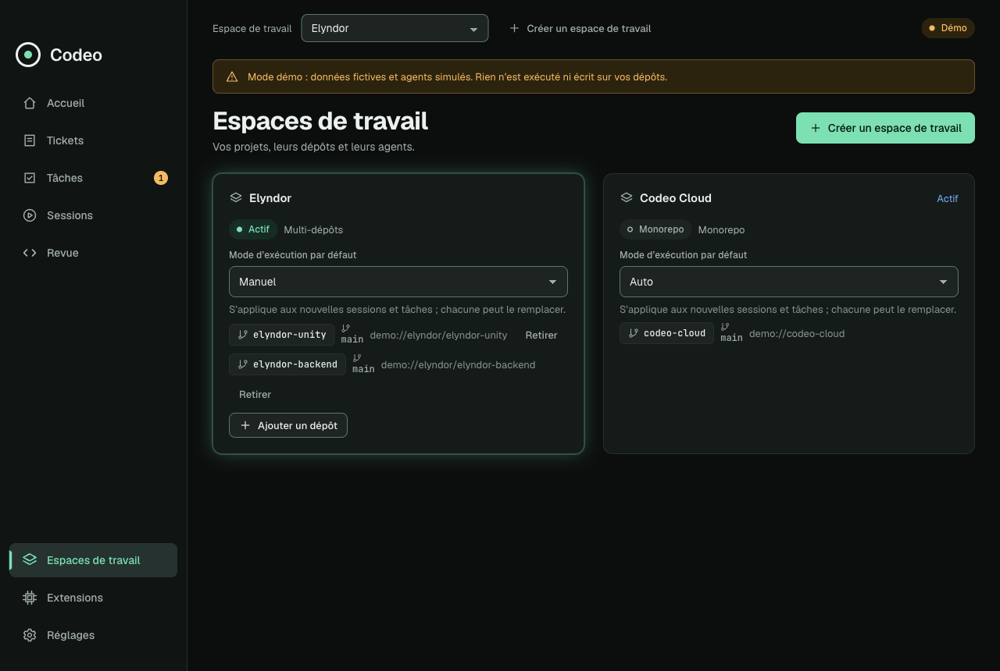

### 2. Pick up a ticket

**Tickets** lists the open GitHub issues of every repository in the workspace, read live with your `gh`
(never stored). Each issue can be opened on GitHub or turned into a task with **Créer la tâche**
(*Create task*); once created, the row offers **Voir la tâche** (*View task*). Below, the task board
follows every task from backlog to done.

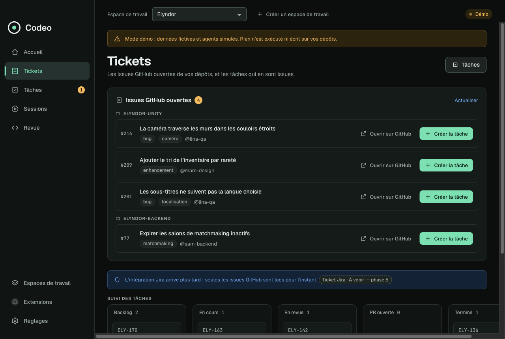

A task created from issue `#209` carries the key `#209`, and its pull request body gets `Closes #209`,
so merging the PR closes the issue.

### 3. Create and start a task

**Créer une tâche** (*Create a task*) is on Home, Tasks and Tickets. The dialog asks for:

- **Source**: a manual instruction or a GitHub issue (title, key and objective are filled from it);
- **Titre / Objectif** (*Title / Objective*): what the agent must accomplish;
- **Dépôts** (*Repositories*): where it works;
- **Orchestration**: one agent, or several (see [below](#orchestrating-several-agents));
- **Mode d'exécution** (*Execution mode*): how much the agent may do without asking
  (see [Execution modes](#execution-modes));
- **Isoler le travail dans des worktrees Git** (*Isolate the work in Git worktrees*), on by default: the
  agent works on a `codeo/…` branch in a separate folder, so your own work in progress is never touched.

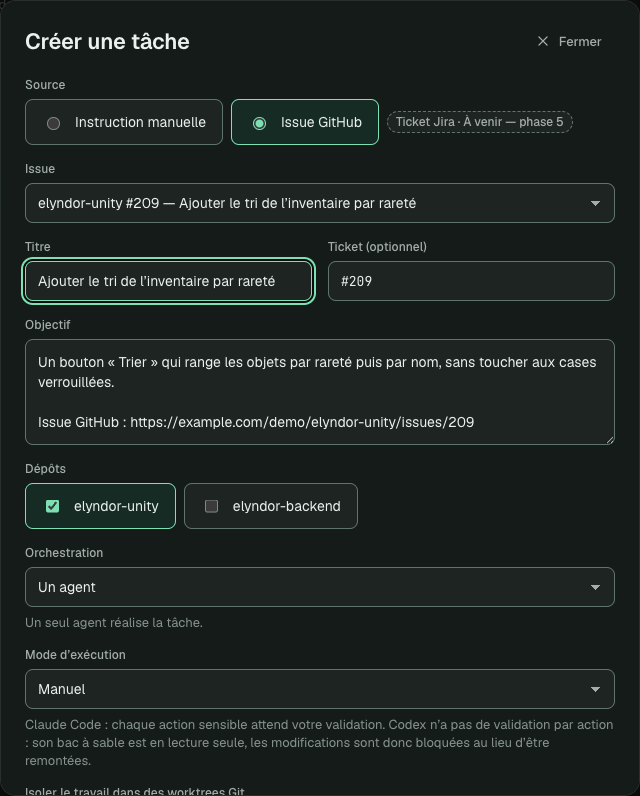

**Créer et démarrer** (*Create and start*) launches the agent right away; **Créer** (*Create*) keeps the
task as a draft.

**Tâches** (*Tasks*) lists every task with its progress, repository and state, filtered by
*Toutes / Actives / En attente / Terminées* (*All / Active / Waiting / Done*). Pending approvals sit at
the top, and the sidebar badge counts them.

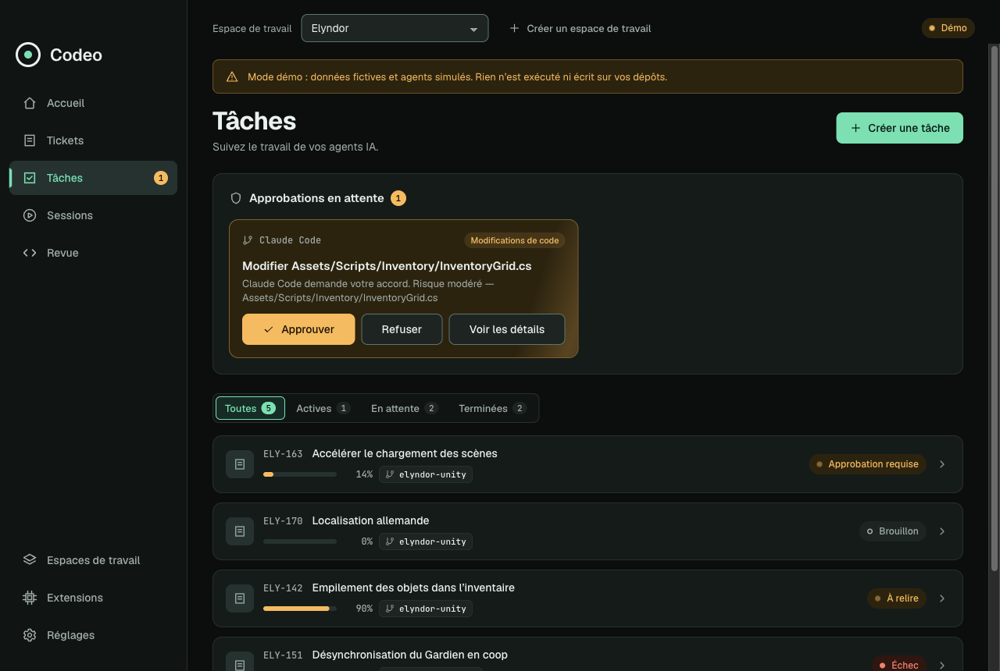

### 4. Follow the session, decide approvals

**Sessions** shows the live conversation with each agent: its messages as they stream, every tool it
uses (`Read`, `Edit`, commands…) and its turn results. The header shows the agent, role, execution mode
and repository, with **Arrêter** (*Stop*). You can write to the agent at any time from the composer.

When the agent wants to do something sensitive (edit a file, run a command, reach the network), the
session pauses on an **approval card**: what it wants to do, the files affected and the risk.
**Approuver** (*Approve*) lets it continue; **Refuser** (*Reject*) denies that action and the agent is
told so. Approval cards also appear on Home and Tasks, and on your phone.

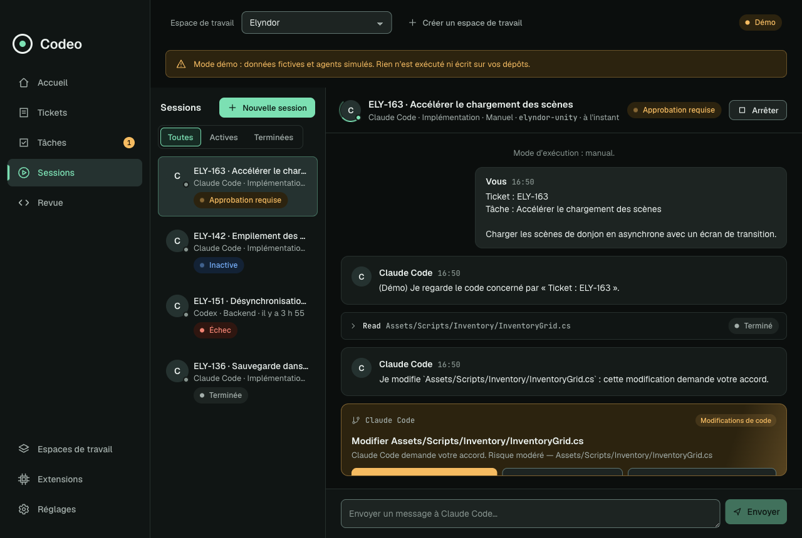

### 5. Review the changes

When the agent finishes, the task moves to **Revue** (*Review*). Select it to see the diff of its
worktree against the base branch: branch name, files changed, additions and deletions, with syntax
highlighting.

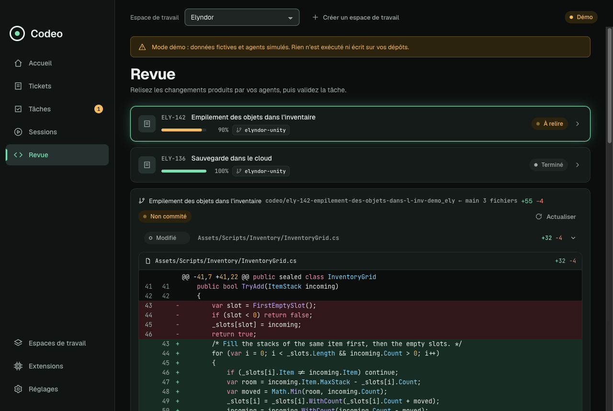

Not right yet? Click any diff line to comment on it, add general feedback, and **Renvoyer à l'agent**
(*Send back to the agent*): the same agent picks it up in its session and worktree, and the task comes
back to review when it is done. When you are happy, **Valider la tâche** (*Complete the task*).

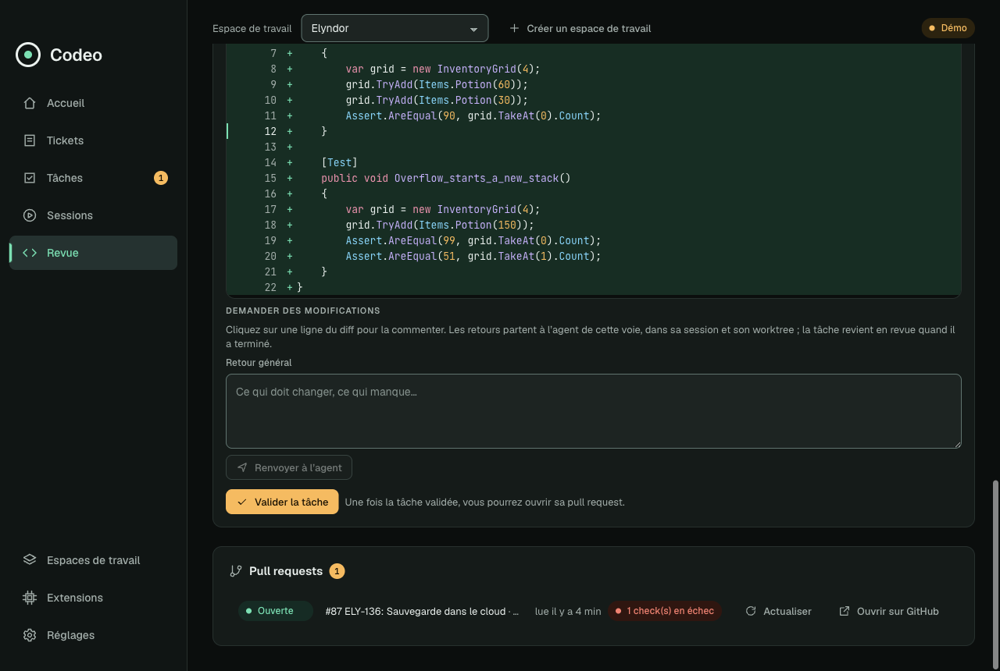

### 6. Open the pull request

Once the task is completed, **Créer la pull request** (*Create the pull request*) commits the work on its
branch, pushes it to `origin` (never forcing) and opens the PR with your GitHub CLI. Codeo then follows
it: state (open, approved, merged), checks (failing, running, passed) and a link to GitHub. If the agent
adds more work, **Publier les nouveaux changements** (*Publish new changes*) updates the same PR. Once
the PR is merged, its worktree is removed (if clean); the branch is kept.

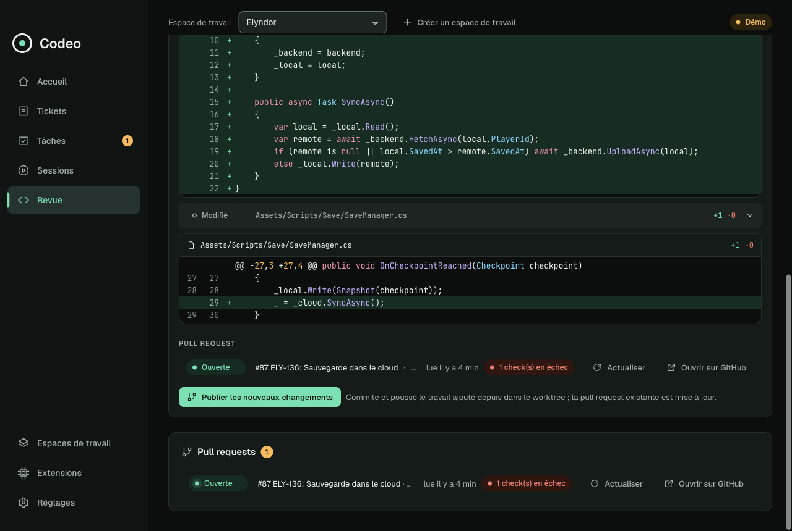

## Home: what needs my attention

Home answers one question: *what needs me now?* The current activity (task, progress, agents, what it
waits for), with shortcuts to resume the session, view the task or review it; then active agents,
pending approvals, recent failures and open pull requests.

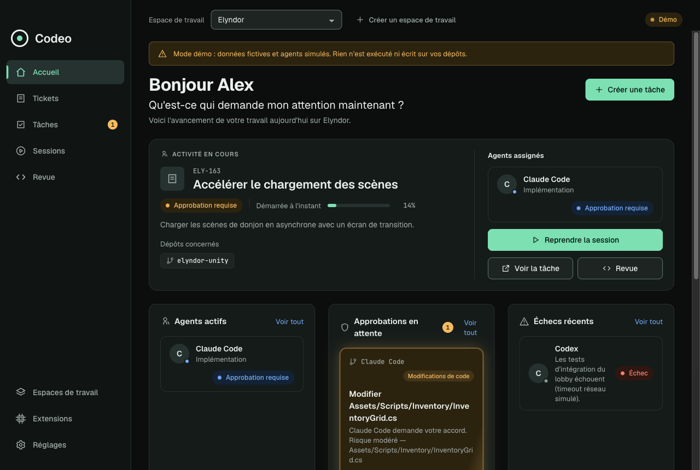

## Standalone sessions

Not everything needs a task. **Sessions → Nouvelle session** (*New session*) starts an agent on one
repository with a free instruction: pick the agent, its role, the execution mode and whether to isolate
it in its own worktree (on by default, on a `codeo/session-…` branch).

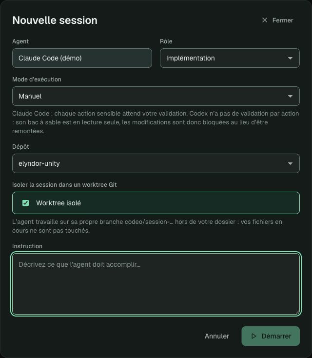

## Execution modes

Set per workspace (default) and overridable per task or session.

| Mode | What the agent does |
| --- | --- |
| **Manuel** (*Manual*) | Claude Code asks before every sensitive action. Codex has no per-action approval: its sandbox is read-only, so changes are blocked rather than escalated. |
| **Auto** | The agent works on its own. Claude Code's auto mode approves routine actions and escalates only what it cannot clear; Codex edits inside the workspace sandbox and its auto-review decides what may leave it. |
| **Pleine autonomie** (*Full autonomy*) | Unattended: the agent waits for no approval. Only when you understand the risks. |

## Orchestrating several agents

The **Orchestration** field of a task puts more than one agent on it:

| Mode | How it runs |
| --- | --- |
| One agent | A single agent does the task. |
| Sequential | Agents work one after another in the same worktree. |
| Pipeline | Like sequential, and each step receives the previous steps' output. |
| Parallel | Agents work at the same time, each in its own worktree; a subtask can wait for others. |
| Best-of-N | Several agents attempt the same objective; in review you keep the best proposal. |

## Settings

**Réglages** (*Settings*): detected agents, theme (dark, light, system) and focus mode (fewer
animations), language, runtime information, demo mode, remote access and updates.

## Codeo Remote (phone)

Codeo Remote (`apps/mobile`, Expo) is a remote control for the runtime on your computer: follow sessions,
send messages and decide approvals (confirmed with Face ID / Touch ID), with a push notification when an
approval waits. It can never administer workspaces.

1. On the computer: **Réglages → Accès distant** (*Settings → Remote access*), enter the gateway URL and
   turn remote access on. The runtime dials out to the gateway; no port is opened on your machine.
2. **Jumeler un téléphone** (*Pair a phone*) shows a single-use QR code and the runtime fingerprint.
3. Scan it with Codeo Remote (or type the code). The phone checks the runtime fingerprint on every
   connection; you can revoke it from either side.

Remote access is not available in demo mode. Details: [Remote access](../security/remote-access.md).

## Troubleshooting

| Symptom | What to check |
| --- | --- |
| An agent shows *Non installé* / *Non authentifié* | Install the CLI and log in (`claude`, `codex login`), then **Actualiser** (*Refresh*) in Settings. |
| Tickets: *Impossible de lire les issues* | The repository needs a GitHub remote and a logged-in `gh` (`gh auth status`). |
| *Créer la pull request* refused | `gh` missing or logged out (`gh auth login`), or no change in the worktree. |
| A worktree cannot be removed | It has uncommitted changes: confirm *Abandonner et supprimer* (*Discard and remove*). The branch is kept. |

Current state and known limitations: [Progress](../development/progress.md).
